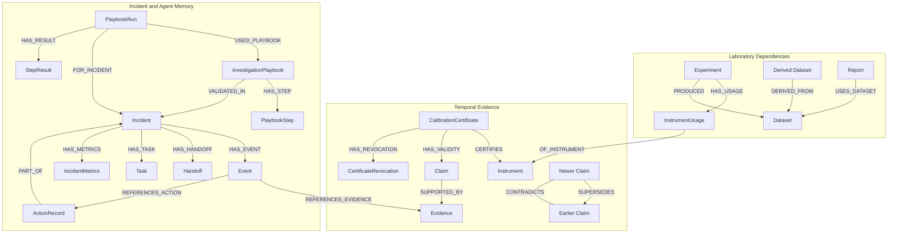

# Temproven

> **"When evidence changes, every dependent decision must be reconsidered."**

A temporal-graph laboratory integrity and incident-learning system built on **synthetic** records. Temproven is a software workflow-enforcement demo — it does not certify real science or control real equipment.

Built for **Graph Hacks 2026** (WeMakeDevs × FalkorDB).

---

## What It Is and Is Not

**Is:** A demonstration of temporal graph reasoning over connected dependencies that triggers application actions, including quarantine, publication gating, task assignment, and reusable investigation memory, backed by FalkorDB.

**Is not:** A certification system, a real laboratory tool, an authenticated or multi-tenant service, or a general performance benchmark.

---

## Tracks Entered

- **Track 1 — Agents That Act on Connected Data:** Temporal graph reasoning changes application behavior through quarantine, publication gating, and task assignment.
- **Track 2 — Agent Memory and Coordination:** Episodic, semantic, and procedural memory persist in FalkorDB. Three agents coordinate through durable handoff records, and a verified playbook from Incident 1 is reused and validated in Incident 2.

---

## Quick Setup

### Prerequisites

- Python 3.13 or a compatible Python version
- Docker Desktop
- Git

### 1. Start FalkorDB

Ensure Docker Desktop is running, then run:

```powershell
docker run -d --name falkordb `
  -p 6379:6379 `
  -p 3000:3000 `
  -v falkordb_data:/data `
  falkordb/falkordb:latest
```

If a container named `falkordb` already exists, start it instead:

```powershell
docker start falkordb
```

### 2. Clone the Repository

```powershell
git clone https://github.com/Santhosh0337/Temproven.git
cd Temproven
```

### 3. Create the Python Environment

```powershell
python -m venv .venv
.\.venv\Scripts\python.exe -m pip install -r requirements.txt
```

### 4. Configure the Environment

```powershell
Copy-Item .env.example .env
```

The example configuration uses a local FalkorDB instance. Adjust `.env` if your connection settings differ.

### 5. Initialize the Demo Data

```powershell
.\.venv\Scripts\python.exe -m temproven.seed.seed
```

### 6. Run the CLI Demonstration

```powershell
.\.venv\Scripts\python.exe -m temproven.demo --act all
```

### 7. Launch the Dashboard

```powershell
.\.venv\Scripts\python.exe -m streamlit run temproven/app/streamlit_app.py
```

Open the local URL printed by Streamlit in your browser.

### 8. Run the Tests

```powershell
.\.venv\Scripts\python.exe -m pytest tests/
```

**Note:** These commands describe the intended setup flow. A fresh-clone installation should be verified before claiming the complete setup has been tested.

---

## Streamlit UI Dashboard Architecture

The Temproven dashboard (`temproven/app/streamlit_app.py`) provides four core capability panels.

### 1. Incident Overview and Interactive Event Timeline

- Incident metadata, including ID, type, status, instrument, and UTC/IST timestamps.
- Evidence revision details distinguishing **valid time** — when evidence applies — from **recorded time** — when the system recorded it.
- Summary figures for affected experiments, datasets, reports, and tasks.
- Interactive event timeline positioned by persisted sequence number (`seq`), not timestamp.
- Distinct markers for significant and routine events.
- Hover tooltips showing sequence, category, event type, summary, actor, and recorded time.
- Event selection with a detailed inspection panel.
- Category filters, event counts, and a notice when events are hidden by filtering.
- Horizontal and vertical timeline layouts.
- Previous, next, go-to-sequence, and clear-selection controls.
- Full event details, including actor, timestamps, outcome, references, targets, and JSON payload.
- Collapsed stage summary and complete audit trail ordered by event sequence.

The timeline explicitly states:

> Line = recorded event sequence, not causation.

### 2. Downstream Impact Trace

- A graph visualization showing dependencies from instruments through experiments and datasets to downstream reports.
- Inspection tables for affected datasets, experiment coverage and gaps, and downstream reports marked held or requiring review.

### 3. Investigation, Verified Playbook, and Procedural Memory

- Reusable investigation playbook metadata and verification status.
- Postcondition checklist covering PC1 through PC6.
- Step-by-step execution outcomes marked `PASSED` or `DIFFERED`.
- Semantic-memory belief-change explanations and investigation-query efficiency metrics.

### 4. Backend Publication Gate

- Upstream dependency inspection for reports.
- Publication-attempt control guarded by an explicit user-confirmation checkbox.
- Decision block displaying `ALLOW`, `BLOCK`, or `REVIEW_REQUIRED`, with justification and audit timestamps.

---

## Graph Schema, Cypher Queries, and Time Semantics

Temproven uses **FalkorDB as its primary graph database**. The graph stores laboratory dependency relationships, temporal evidence claims, incident events, agent coordination records, procedural memory, remediation actions, and publication decisions.

### 1. Graph Model

The schema defines indexes on the `id` property for the following 22 node labels:

| Domain | Node labels |
|---|---|
| Laboratory entities | `Instrument`, `CalibrationCertificate`, `CertificateRevocation`, `Experiment`, `InstrumentUsage`, `Dataset`, `Report`, `Scientist`, `Observation` |
| Evidence and temporal claims | `Claim`, `Evidence` |
| Incident history | `Incident`, `Event`, `ActionRecord`, `Task`, `PublicationAttempt` |
| Agent coordination | `Handoff` |
| Procedural memory | `InvestigationPlaybook`, `PlaybookStep`, `PlaybookRun`, `StepResult` |
| Metrics | `IncidentMetrics` |

#### Graph Relationship Map

The diagram below shows the main entities and relationships used by Temproven. Arrows follow the stored relationship direction.



Additional property indexes are defined for:

- `Claim.subject_id`
- `Claim.claim_type`
- `InstrumentUsage.required_scope`
- `CalibrationCertificate.scope`
- `Event.incident_id`
- `Handoff.incident_id`
- `Task.incident_id`

The indexes support lookups used by temporal evaluation, incident investigation, event retrieval, and agent coordination.

### 2. Important Relationships

The graph connects records through typed relationships. The principal relationships include:

| Relationship | Purpose |
|---|---|
| `(:CalibrationCertificate)-[:CERTIFIES]->(:Instrument)` | Connects a certificate to the instrument it certifies. |
| `(:CalibrationCertificate)-[:HAS_VALIDITY]->(:Claim)` | Associates a certificate with validity claims. |
| `(:Claim)-[:SUPPORTED_BY]->(:Evidence)` | Records the evidence supporting a claim. |
| `(:Claim)-[:SUPERSEDES]->(:Claim)` | Represents a newer claim superseding an earlier claim. |
| `(:Claim)-[:CONTRADICTS]-(:Claim)` | Represents contradictory claims. |
| `(:CalibrationCertificate)-[:HAS_REVOCATION]->(:CertificateRevocation)` | Connects a certificate to revocation records. |
| `(:Experiment)-[:HAS_USAGE]->(:InstrumentUsage)-[:OF_INSTRUMENT]->(:Instrument)` | Connects an experiment to an instrument usage. |
| `(:Experiment)-[:PRODUCED]->(:Dataset)` | Connects experiments to produced datasets. |
| `(:Dataset)-[:DERIVED_FROM]->(:Dataset)` | Represents dataset lineage and derived data. |
| `(:Report)-[:USES_DATASET]->(:Dataset)` | Connects reports to their input datasets. |
| `(:Incident)-[:HAS_EVENT]->(:Event)` | Persists incident event history. |
| `(:Incident)-[:HAS_HANDOFF]->(:Handoff)` | Persists agent coordination records. |
| `(:Incident)-[:HAS_TASK]->(:Task)` | Connects incidents to assigned or escalated tasks. |
| `(:ActionRecord)-[:PART_OF]->(:Incident)` | Associates remediation action records with incidents. |
| `(:Event)-[:REFERENCES_EVIDENCE]->(:Evidence)` | Links events to relevant evidence. |
| `(:Event)-[:REFERENCES_ACTION]->(:ActionRecord)` | Links events to action records. |
| `(:InvestigationPlaybook)-[:HAS_STEP]->(:PlaybookStep)` | Connects a playbook to its steps. |
| `(:PlaybookRun)-[:USED_PLAYBOOK]->(:InvestigationPlaybook)` | Records which playbook was executed. |
| `(:PlaybookRun)-[:FOR_INCIDENT]->(:Incident)` | Associates a playbook run with an incident. |
| `(:PlaybookRun)-[:HAS_RESULT]->(:StepResult)` | Persists individual step results. |
| `(:InvestigationPlaybook)-[:VALIDATED_IN]->(:Incident)` | Records successful playbook validation in an incident. |
| `(:Incident)-[:HAS_METRICS]->(:IncidentMetrics)` | Associates persisted workflow metrics with an incident. |

Other relationships in the implementation include `CONCERNS_INSTRUMENT`, `OWNS`, `PERFORMED`, `CUSTODIAN_OF`, `FOLLOWS`, `NEXT`, `HAS_ATTEMPT`, `HAS_USAGE`, `HAS_REVOCATION`, and `DERIVED_FROM_INCIDENT`.

### 3. Representative Cypher Queries

The following examples are adapted from the queries in `temproven/graph/queries.py`. Parameters are supplied separately by the application.

#### A. Trace downstream impact

This query starts with an experiment, follows dataset derivation relationships, and identifies reports that use affected datasets.

```cypher
MATCH (exp:Experiment {id: $exp_id})-[:PRODUCED]->(root_ds:Dataset)
OPTIONAL MATCH (child_ds:Dataset)-[:DERIVED_FROM*0..6]->(root_ds)
WITH root_ds, collect(DISTINCT child_ds) + [root_ds] AS all_ds_nodes
UNWIND all_ds_nodes AS ds
WITH DISTINCT ds
OPTIONAL MATCH (rpt:Report)-[:USES_DATASET]->(ds)
RETURN
    ds.id AS dataset_id,
    ds.name AS dataset_name,
    ds.status AS dataset_status,
    rpt.id AS report_id,
    rpt.title AS report_title,
    rpt.publication_status AS report_status
```

This traversal supports downstream impact assessment by connecting experimental outputs to derived datasets and dependent reports.

#### B. Retrieve certificate claims and evidence history

This query retrieves certificate claims and associated evidence while examining superseding claims, revocations, and contradictions as of a supplied recorded-time cutoff.

```cypher
MATCH (exp:Experiment)-[:HAS_USAGE]->(u:InstrumentUsage)
MATCH (u)-[:OF_INSTRUMENT]->(inst:Instrument)
WHERE ($usage_id IS NULL OR u.id = $usage_id)
  AND ($experiment_id IS NULL OR exp.id = $experiment_id)
  AND ($instrument_id IS NULL OR inst.id = $instrument_id)
OPTIONAL MATCH (cert:CalibrationCertificate)-[:CERTIFIES]->(inst)
WHERE cert.recorded_at <= $t
  AND cert.scope = u.required_scope
OPTIONAL MATCH (cert)-[:HAS_VALIDITY]->(c:Claim)
WHERE c.claim_type = 'CERT_VALIDITY'
  AND c.recorded_at <= $t
  AND c.verified_at IS NOT NULL
  AND c.verified_at <= $t
OPTIONAL MATCH (s:Claim)-[:SUPERSEDES]->(c)
WHERE s.recorded_at <= $t
  AND s.verified_at IS NOT NULL
  AND s.verified_at <= $t
OPTIONAL MATCH (c)-[:SUPPORTED_BY]->(ev:Evidence)
OPTIONAL MATCH (cert)-[:HAS_REVOCATION]->(rev:CertificateRevocation)
WHERE rev.recorded_at <= $t
OPTIONAL MATCH (c)-[:CONTRADICTS]-(contra:Claim)
WHERE contra.recorded_at <= $t
RETURN
    exp.id AS experiment_id,
    u.id AS usage_id,
    inst.id AS instrument_id,
    cert.id AS cert_id,
    c.id AS claim_id,
    c.valid_from AS valid_from,
    c.valid_until AS valid_until,
    c.recorded_at AS claim_recorded_at,
    c.verified_at AS claim_verified_at,
    ev.id AS evidence_id,
    count(DISTINCT s) AS num_superseders
```

The complete application query also returns usage dates, required scope, certificate scope, and collections describing revocations and contradictions. The example above highlights the core temporal and evidence fields.

#### C. Persist an incident event

Events are stored with a sequence number scoped to their incident. The next sequence is obtained from the incident's `next_seq` property.

```cypher
MATCH (inc:Incident {id: $incident_id})
WITH inc, coalesce(inc.next_seq, 1) AS cur_seq
SET inc.next_seq = cur_seq + 1
CREATE (ev:Event {
    id: $event_id,
    incident_id: $incident_id,
    seq: cur_seq,
    event_type: $event_type,
    at: $at,
    actor_agent: $actor_agent,
    summary: $summary,
    outcome: $outcome,
    logical_key: $logical_key,
    payload_json: $payload_json
})
CREATE (inc)-[:HAS_EVENT]->(ev)
RETURN ev.id AS id, ev.seq AS seq
```

The full implementation also links events to evidence and action records where applicable and connects successive events through `FOLLOWS` relationships.

#### D. Retrieve pending agent handoffs

Agents coordinate through persistent graph records rather than relying only on in-memory messages.

```cypher
MATCH (h:Handoff {
    incident_id: $incident_id,
    status: 'PENDING'
})
RETURN
    h.id AS id,
    h.incident_id AS incident_id,
    h.from_agent AS from_agent,
    h.to_agent AS to_agent,
    h.task_type AS task_type,
    h.payload_json AS payload_json,
    h.idempotency_key AS idempotency_key,
    h.created_at AS created_at,
    h.attempt_count AS attempt_count
ORDER BY h.created_at ASC
```

The orchestrator claims pending handoffs, routes work to the relevant agent handler, and persists completion or failure results. Handoffs have explicit statuses and lease-related fields.

#### E. Record a publication attempt

The publication gate persists the decision and its associated justification and evidence path.

```cypher
MATCH (rpt:Report {id: $report_id})
CREATE (pa:PublicationAttempt {
    id: $attempt_id,
    report_id: $report_id,
    actor: $actor,
    result: $result,
    reason: $reason,
    evidence_path_json: $evidence_path_json,
    at: $at
})
CREATE (rpt)-[:HAS_ATTEMPT]->(pa)
RETURN pa.id AS id
```

The application evaluates upstream dependencies before recording the publication attempt. This query persists the result; it is not, by itself, the decision rule.

### 4. Temporal Semantics

Temproven distinguishes valid time from recorded time.

- **Valid time:** `valid_from` and `valid_until` describe the period during which a claim applies in the modeled timeline.
- **Recorded time:** `recorded_at` records when a claim or evidence record entered the system.
- **Verification time:** `verified_at` records when a claim was verified.
- **Evidence observation time:** `observed_at` records when the associated evidence was observed.
- **Event sequence:** `seq` provides an explicit ordering of persisted events within an incident.

The temporal evaluation code uses these fields to assess whether a claim was recorded and verified by a specified cutoff, whether it has been superseded, and whether revocation or contradictory evidence affects the investigation.

The event timeline uses persisted sequence numbers for ordering. Sequence order should not be interpreted as proof of causation.

### 5. Graph-Backed Agent Coordination and Memory

Temproven implements deterministic, specialized agent handlers coordinated through persisted handoffs:

- **EvidenceAgent:** Ingests evidence and claims, records supersession or contradiction relationships, and initiates the next workflow handoff.
- **IntegrityAgent:** Selects and validates investigation playbooks and participates in verification and closure.
- **ImpactAgent:** Assesses downstream impact and applies approved remediation actions.

Memory is represented through graph records:

- **Episodic memory:** `Event` nodes and incident event relationships.
- **Semantic memory:** Evidence-supported `Claim` nodes, validity intervals, verification timestamps, supersession, and contradiction relationships.
- **Procedural memory:** `InvestigationPlaybook`, `PlaybookStep`, `PlaybookRun`, and `StepResult` nodes.

The agents use deterministic application logic and persisted graph state; this submission does not use LLM inference.

### 6. Implementation Notes

- Schema indexes are defined in `temproven/graph/schema.py`.
- Representative parameterized queries are defined in `temproven/graph/queries.py`.
- Evidence ingestion and agent handoffs are implemented in `temproven/agents/`.
- Temporal evaluation is implemented in `temproven/domain/temporal.py`.
- Episodic and procedural memory are implemented in `temproven/memory/`.

The graph schema and query examples describe the current implementation. They are not a claim of laboratory certification, production concurrency guarantees, or general performance benchmarks.

## AI-Assistance Disclosure

This project was developed with assistance from **Antigravity**, an AI coding assistant.

AI assistance was used to:

- Generate boilerplate project structure and module stubs.
- Draft Cypher query implementations.
- Suggest test cases for temporal edge conditions.

The participant reviewed and tested the implementation and is responsible for understanding the submitted code, graph model, temporal semantics, and architectural decisions. The implementation should be explained and demonstrated accurately.

---

## Limitations

- Synthetic data only; no real laboratory records.
- No authentication or tenant isolation.
- Quarantine release is not implemented.
- Concurrency safety has not been tested; the demo targets a single-threaded workflow.
- LLM integration is absent from this submission; the agents use deterministic, graph-backed workflows.
- Performance measurements apply only to the synthetic demonstration scenario and are not general performance claims.

---

## Demo

Demo video: https://youtu.be/wbsdmBwydu8
 
---

## Repository

Source code: https://github.com/Santhosh0337/Temproven
